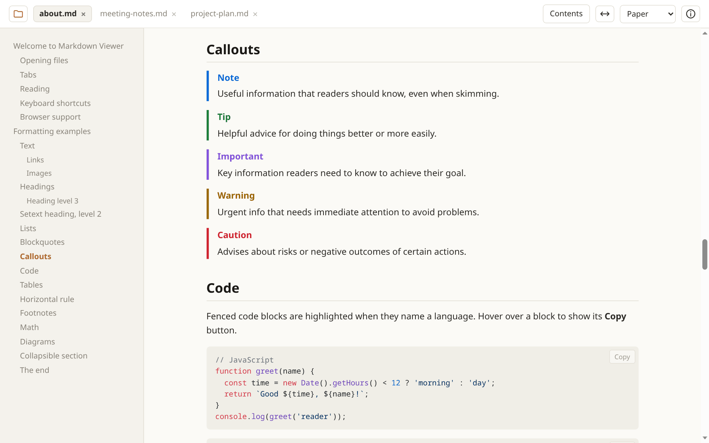

<p align="center">
  
</p>

<h1 align="center">Markdown Viewer</h1>

<p align="center">
  A quiet, read-only Markdown viewer that runs in your browser and installs as an app.<br>
  Open your <code>.md</code> files, read them comfortably, and see changes the moment you save.
</p>

<p align="center">
  <a href="https://randomblog.hu/tools/md-viewer/"><strong>Open Markdown Viewer →</strong></a>
</p>

<picture>
  <source media="(prefers-color-scheme: dark)" srcset="docs/screenshot-dark.png">
  
</picture>

## Why

Most Markdown tools are editors. This one only shows the document, so it stays out of the way while you write
in the editor you already use. Keep it open next to your editor: every time you save, it updates in place and keeps
your scroll position.

Your files never leave your computer. The viewer reads them directly in the browser; there's no server, no upload
and no account.

## Features

**Opening files**

- Folder button or <kbd>Ctrl</kbd> <kbd>O</kbd>, or drag and drop one or more files onto the window
- Install it as an app and set it as the default for `.md` files, then just double-click them in your file manager
- Each file opens in its own tab; drag tabs to reorder them
- Your tabs come back next time, and recently opened files are listed on the start screen

**Reading**

- Auto-refresh: saved changes appear within a second, without losing your place
- Contents sidebar that highlights the section you're reading, with smooth scrolling
- 10 color themes (5 dark, 5 light), full-width mode, and text zoom that scales only the document
- Copy button on every code block
- Clean print layout, and it works offline once loaded

**Rendering**

- GitHub Flavored Markdown: tables, task lists, strikethrough, autolinks
- Syntax highlighting for code blocks
- GitHub-style callouts (`> [!NOTE]`, `[!TIP]`, `[!IMPORTANT]`, `[!WARNING]`, `[!CAUTION]`)
- Footnotes, and math with KaTeX (`$inline$` and `$$display$$`)
- Mermaid diagrams that follow the light or dark theme
- Front matter shown as a collapsible *Properties* table
- All HTML is sanitized, so a document can't run scripts

The built-in [about page](about.md) opens on your first visit. It lists every feature and shortcut, followed by an
example of every kind of formatting. You can reopen it any time with the ⓘ button.

## Keyboard shortcuts

| Shortcut | Action |
|:--|:--|
| <kbd>Ctrl</kbd> <kbd>O</kbd> | Open files |
| <kbd>Ctrl</kbd> <kbd>W</kbd> \* | Close the current document |
| <kbd>Ctrl</kbd> <kbd>Tab</kbd> / <kbd>Ctrl</kbd> <kbd>Shift</kbd> <kbd>Tab</kbd> \* | Next / previous tab |
| <kbd>Ctrl</kbd> <kbd>1</kbd>…<kbd>8</kbd>, <kbd>Ctrl</kbd> <kbd>9</kbd> \* | Go to a tab, or to the last tab |
| <kbd>Ctrl</kbd> <kbd>+</kbd> / <kbd>−</kbd> / <kbd>0</kbd> | Larger / smaller / reset text size |

\* Only in the installed app. In a normal browser tab these keep their usual browser meaning.
Use <kbd>Cmd</kbd> instead of <kbd>Ctrl</kbd> on a Mac. The [about page](about.md#keyboard-shortcuts) has the full list.

## Browser support

Markdown Viewer works in any modern browser. Chrome and Edge get the most out of it, because they let a web page
keep access to a file you opened. That's what makes these work:

- auto-refresh when a file is saved
- reopening recent files and restoring tabs with their current contents
- opening files from the file manager after installing the app

In other browsers each file is shown as it was when you opened it.

Relative links and images (like `img/photo.png`) don't load, because the browser only gives the viewer the file's
contents, not its folder. Images from the web work.

## Install as an app

1. Open [Markdown Viewer](https://randomblog.hu/tools/md-viewer/) in Chrome or Edge.
2. Click the install icon at the right end of the address bar, or open the browser menu and choose
   *Cast, save and share → Install page as app*.
3. To open `.md` files with a double-click, set Markdown Viewer as the default app for Markdown files in your
   operating system. The first time, the browser asks whether the app may open the file.

## Running it yourself

It's plain HTML, CSS and JavaScript, with no build step and no dependencies to install. The libraries load from
the jsDelivr CDN at pinned versions.

```sh
git clone https://github.com/bakatamas/md-viewer.git
cd md-viewer
python3 -m http.server 8000
```

Then open <http://localhost:8000>. It has to be served over HTTP or HTTPS: the service worker and the file access
APIs don't work from `file://`. To install it as an app from your own server, serve it over HTTPS.

When you change any file, bump `VERSION` in `sw.js`. Otherwise installed copies keep using their cached version.

## Built with

- [marked](https://marked.js.org) for parsing Markdown, with [marked-footnote](https://github.com/bent10/marked-extensions/tree/main/packages/footnote)
  and [marked-katex-extension](https://github.com/UziTech/marked-katex-extension)
- [DOMPurify](https://github.com/cure53/DOMPurify) for sanitizing HTML
- [highlight.js](https://highlightjs.org) for syntax highlighting
- [KaTeX](https://katex.org) for math
- [Mermaid](https://mermaid.js.org) for diagrams

The color themes come from the [Redmine Textile editor](https://randomblog.hu/tools/redmine-ticket/).
