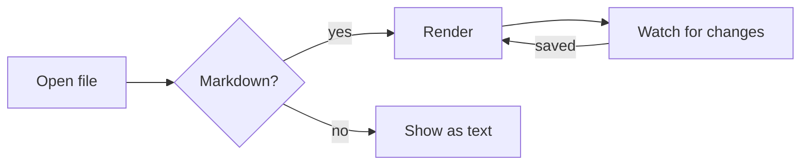
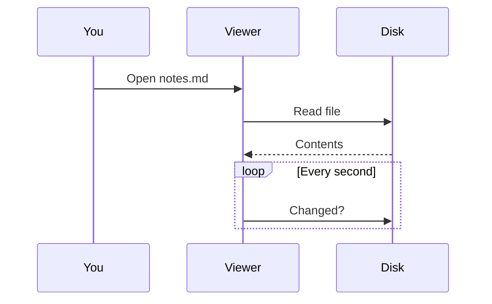
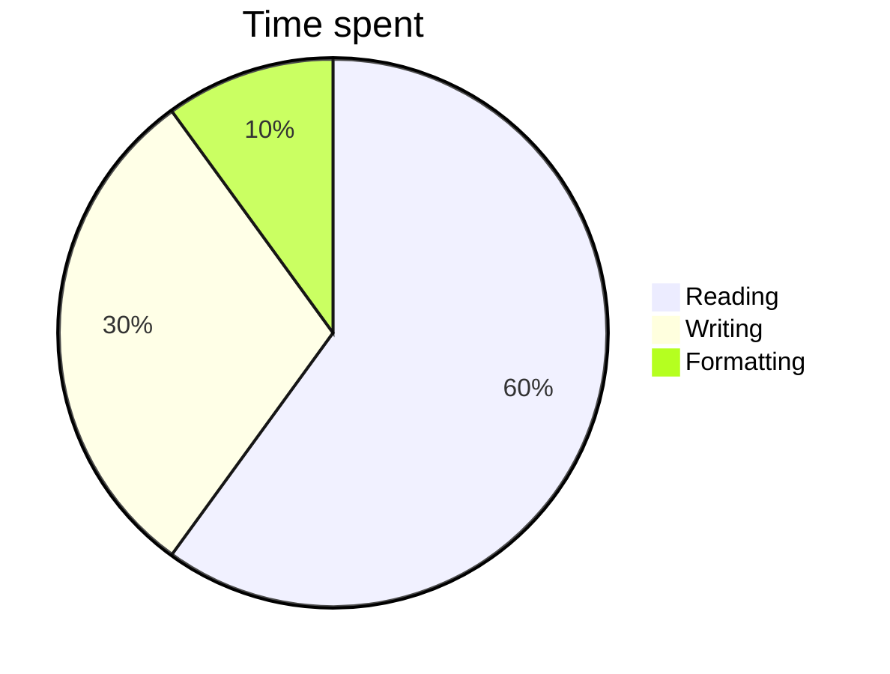

# Welcome to Markdown Viewer

A quiet, read-only viewer for Markdown files. This built-in about page opens on your first visit: it lists what the
viewer can do and its keyboard shortcuts, followed by examples of every kind of formatting it can display. Jump
between sections with the **Contents** sidebar[^contents], and close this tab with **×** when you're done. You can
reopen it any time with the **ⓘ** button at the top right.

## Opening files

- **Folder button** or <kbd>Ctrl</kbd> <kbd>O</kbd> opens the file picker. You can select several files at once.
- **Drag and drop** one or more files anywhere on the window.
- **From your file manager**: install the viewer as an app (Chrome's install button in the address bar), set it as
  the default app for `.md` files, then double-click any Markdown file.
- **Recent files** are listed when no document is open. Click one to reopen it, or **×** to remove it from the list.
- **Your tabs come back** the next time you open the viewer. After a browser restart, a reopened file may first
  show the copy saved last time, with a **Reconnect to file** bar: click it to load the current version.

## Tabs

- Each file opens in its own tab. Opening a file that's already open switches to its tab.
- Close a tab with its **×**, a middle-click, or <kbd>Ctrl</kbd> <kbd>W</kbd>.
- Drag tabs to change their order.
- If a file is moved or deleted, its tab name is struck through and the last version stays on screen.

## Reading

- **Auto-refresh**: when you save an open file in your editor, the viewer updates within a second and keeps your
  place.
- **Contents** sidebar: lists the document's headings, highlights the section you're reading, and scrolls smoothly
  to the one you click. The **Contents** button shows or hides it.
- **Full width** (the ↔ button) lets the text use the whole window instead of a comfortable reading width.
- **Text zoom** makes the document's text larger or smaller without zooming the rest of the app.
- **Themes**: pick one of 10 color themes, 5 dark and 5 light, from the menu at the top right.
- **About** (the **ⓘ** button) opens this page.
- **Code blocks** have a **Copy** button that appears when you hover over them.
- **Front matter** (the `key: value` block some files start with) is shown as a collapsed *Properties* table.
- **Printing** leaves out the toolbar and sidebar, so only the document is printed.
- **Works offline** once it has been opened, and can be installed as an app.

All settings (theme, sidebar, width, zoom) are remembered.

## Keyboard shortcuts

On a Mac, use <kbd>Cmd</kbd> instead of <kbd>Ctrl</kbd>.

| Shortcut | Action | Installed app only |
|:---------|:-------|:------------------:|
| <kbd>Ctrl</kbd> <kbd>O</kbd> | Open files | |
| <kbd>Ctrl</kbd> <kbd>W</kbd> | Close the current document (closes the window when none is open) | ✓ |
| <kbd>Ctrl</kbd> <kbd>Tab</kbd> / <kbd>Ctrl</kbd> <kbd>Shift</kbd> <kbd>Tab</kbd> | Next / previous tab | ✓ |
| <kbd>Ctrl</kbd> <kbd>PgDn</kbd> / <kbd>Ctrl</kbd> <kbd>PgUp</kbd> | Next / previous tab | ✓ |
| <kbd>Ctrl</kbd> <kbd>1</kbd> … <kbd>8</kbd> | Go to tab 1 to 8 | ✓ |
| <kbd>Ctrl</kbd> <kbd>9</kbd> | Go to the last tab | ✓ |
| <kbd>Ctrl</kbd> <kbd>+</kbd> / <kbd>Ctrl</kbd> <kbd>−</kbd> | Larger / smaller text | |
| <kbd>Ctrl</kbd> <kbd>0</kbd> | Reset text size | |
| <kbd>Ctrl</kbd> + mouse wheel, or pinch | Larger / smaller text | |
| <kbd>Tab</kbd> | Move between tabs and buttons | |
| <kbd>Enter</kbd> or <kbd>Space</kbd> on a tab | Switch to it | |
| <kbd>Delete</kbd> on a tab | Close it | |
| <kbd>PgDn</kbd> <kbd>PgUp</kbd> <kbd>Space</kbd> <kbd>↑</kbd> <kbd>↓</kbd> | Scroll the document | |

In a normal browser tab, the shortcuts marked ✓ keep their usual browser meaning (for example, <kbd>Ctrl</kbd>
<kbd>W</kbd> closes the browser tab).

## Browser support

- Auto-refresh, recent files, reconnecting and opening from the file manager need **Chrome or Edge**. Other
  browsers show a static copy of each file, and reopened tabs show the copy saved last time.
- Relative links and images (like `img/photo.png`) don't load, because the viewer is only given the file's
  contents, not its folder. Images from the web work.
- On narrow screens, such as phones, the Contents sidebar and the full-width button are hidden.

# Formatting examples

Everything below shows how each kind of Markdown formatting looks in the viewer. The block at the very top of this
file is **front matter**: it appears as the collapsed *Properties* line above the welcome heading.

## Text

Plain paragraph text wraps to the width of the page. A blank line starts a new paragraph.

**Bold**, *italic*, ***bold italic***, ~~strikethrough~~, `inline code`, and **nested *emphasis* inside bold**.

HTML that's safe is kept: <kbd>Ctrl</kbd> + <kbd>O</kbd>, H<sub>2</sub>O, x<sup>2</sup>, <mark>highlighted</mark>,
<abbr title="Markdown Viewer">MDV</abbr>, and <ins>inserted text</ins>.

A line ending with a backslash\
breaks here, and so does one ending with two spaces  
like this.

Characters can be escaped: \*not italic\*, \`not code\`, \# not a heading, 1\. not a list.

Typographic characters pass through as typed: “quotes”, ‘apostrophes’, en – and em — dashes, ellipsis…, © ® ™ € ½.

### Links

- External link: [CommonMark](https://commonmark.org) (opens in a new tab)
- Bare URL, linked automatically: https://github.github.com/gfm/
- Email autolink: <hello@example.com>
- Link with a title: [hover me](https://example.com "A link title")
- Link within this document: [jump to Tables](#tables)
- Reference-style link: [marked][marked-ref]

[marked-ref]: https://marked.js.org "marked, the Markdown parser this viewer uses"

### Images

An embedded SVG image (see *Browser support* above for which images load):

%22%2F%3E%3Ctext%20x%3D%22120%22%20y%3D%2241%22%20font-family%3D%22sans-serif%22%20font-size%3D%2222%22%20font-weight%3D%22700%22%20fill%3D%22%23fff%22%20text-anchor%3D%22middle%22%3EMarkdown%20Viewer%3C%2Ftext%3E%3C%2Fsvg%3E)

## Headings

The Contents sidebar lists levels 1–3; the current section is highlighted as you scroll.

### Heading level 3

#### Heading level 4

##### Heading level 5

###### Heading level 6

Setext heading, level 2
-----------------------

## Lists

Unordered, with nesting:

- First item
- Second item
  - Nested item
  - Another nested item
    - Third level
- Third item with a second paragraph

  The second paragraph belongs to the same item.

Ordered:

1. One
2. Two
3. Three

An ordered list can start at any number:

7. Seven
8. Eight

Task list:

- [x] Open a Markdown file
- [x] Pick a theme
- [ ] Read everything

Mixed:

1. Step one
   - detail a
   - detail b
2. Step two
   ```sh
   echo "code inside a list item"
   ```

## Blockquotes

> A plain quote.
>
> > A nested quote inside it.
>
> Back at the first level, with **formatting** and `code`.

## Callouts

> [!NOTE]
> Useful information that readers should know, even when skimming.

> [!TIP]
> Helpful advice for doing things better or more easily.

> [!IMPORTANT]
> Key information readers need to know to achieve their goal.

> [!WARNING]
> Urgent info that needs immediate attention to avoid problems.

> [!CAUTION]
> Advises about risks or negative outcomes of certain actions.

## Code

Fenced code blocks are highlighted when they name a language. Hover over a block to show its **Copy** button.

```js
// JavaScript
function greet(name) {
  const time = new Date().getHours() < 12 ? 'morning' : 'day';
  return `Good ${time}, ${name}!`;
}
console.log(greet('reader'));
```

```python
# Python
from dataclasses import dataclass

@dataclass
class Point:
    x: float
    y: float

    def length(self) -> float:
        return (self.x ** 2 + self.y ** 2) ** 0.5
```

```css
/* CSS */
.markdown blockquote.alert { border-left-color: var(--alert); }
```

```json
{ "name": "Markdown Viewer", "display": "standalone", "themes": 10 }
```

```diff
- removed line
+ added line
  unchanged line
```

```bash
# Shell
for f in *.md; do
  echo "Opening $f"
done
```

A block without a language:

```
Plain preformatted text.
    Indentation is kept.
```

An indented code block (four spaces):

    indented code
    is shown the same way

A very long line scrolls sideways instead of wrapping:

```text
This line is deliberately long so that it overflows the width of the page and the code block has to scroll horizontally to show all of it, while the Copy button stays put.
```

## Tables

| Feature      | Left aligned | Centered | Right aligned |
|:-------------|:-------------|:--------:|--------------:|
| Text         | apples       | pears    |          1.00 |
| **Formatted**| *italic*     | `code`   |         12.50 |
| Links        | [marked](https://marked.js.org) | ~~old~~ | 100.00 |

A table with many columns wraps its cells to fit, and scrolls sideways if it still doesn't:

| A | B | C | D | E | F | G | H | I | J |
|---|---|---|---|---|---|---|---|---|---|
| a long cell value | another long cell value | more text here | and more | keeps going | still going | nearly there | almost | last few | done |

## Horizontal rule

Above the rule.

---

Below the rule.

## Footnotes

Footnote references look like this[^1], can use names[^named], and can hold more than one paragraph[^long].
They're collected at the end of the document.

[^1]: A simple footnote.
[^named]: Footnote labels don't have to be numbers; they're numbered in order of use.
[^long]: A longer footnote.

    Its second paragraph is indented by four spaces.
[^contents]: On narrow screens the sidebar is hidden.

## Math

Inline math sits in the text: $E = mc^2$, $a^2 + b^2 = c^2$, and $\sum_{i=1}^{n} i = \frac{n(n+1)}{2}$.
Prices like $5 and $10 are left as text.

Display math gets its own line:

$$
\int_{-\infty}^{\infty} e^{-x^2}\,dx = \sqrt{\pi}
$$

$$
\begin{aligned}
\nabla \cdot \mathbf{E} &= \frac{\rho}{\varepsilon_0} \\
\nabla \times \mathbf{B} &= \mu_0 \mathbf{J} + \mu_0 \varepsilon_0 \frac{\partial \mathbf{E}}{\partial t}
\end{aligned}
$$

A matrix: $\begin{pmatrix} 1 & 2 \\ 3 & 4 \end{pmatrix}$

## Diagrams

Mermaid diagrams follow the light or dark theme.







## Collapsible section

<details>
<summary>Click to expand</summary>

Hidden content, which can contain **Markdown** too.

</details>

## The end

That's everything. Try the zoom shortcuts (<kbd>Ctrl</kbd> <kbd>+</kbd> / <kbd>−</kbd> / <kbd>0</kbd>) and the
full-width button on this page.
